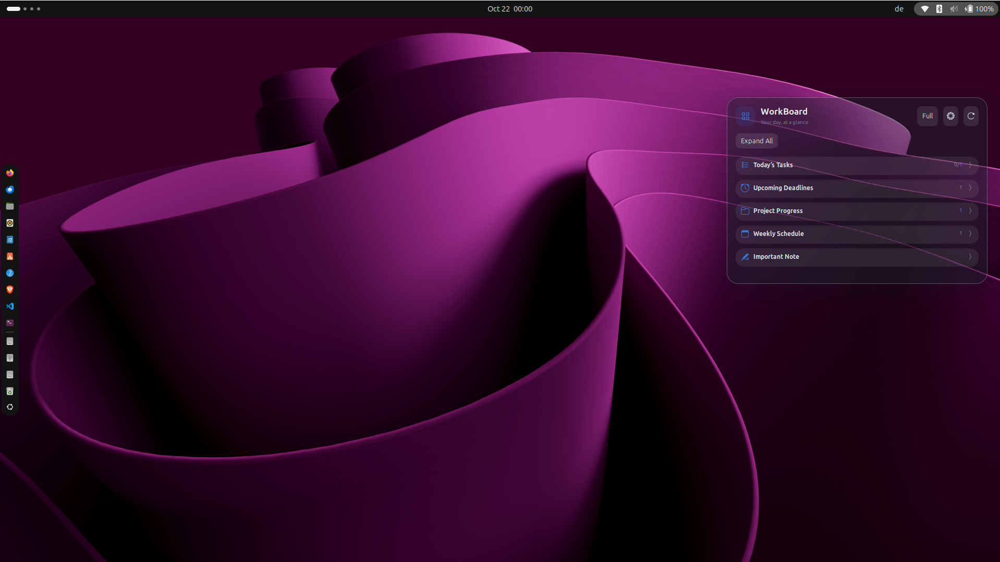

# dboard — Your desktop, organized

**A minimalist, Python-powered productivity widget for Ubuntu GNOME.**

Keep tasks, deadlines, project progress, a weekly schedule, and quick notes directly on your desktop. No extra app window, account, or cloud service required.

**Release:** `v1.0.0` · **Platform tested:** Ubuntu 26.04 / GNOME Shell 50 / Wayland · **Stack:** Python 3, GJS, JavaScript, CSS



> **Note:** dboard is a GNOME Shell extension backed by Python, not a standalone executable. It is developed and tested for a GNOME 50 Wayland session. Other versions are not yet verified.

## Why dboard?

dboard turns your desktop into a simple productivity space. When you return to your desktop, you can see what needs attention and update it there, instead of opening a separate to-do application. The interface features rounded translucent panels, symbolic icons, and compact or expanded views.

## Features

| Area | What you can do |
| --- | --- |
| **Daily tasks** | Add tasks, rename them with the pencil icon, check them off, or delete them. |
| **Deadlines** | Add or remove dated reminders; see days remaining, due-today, and overdue indicators. |
| **Project progress** | Add projects and change completion in 10-percentage-point increments, from 0% to 100%. |
| **Weekly schedule** | Add or remove recurring day/time/activity entries; today's entries are highlighted. |
| **Important note** | Save and replace a quick reminder. |
| **Layout controls** | Expand or collapse individual sections, expand/collapse all, and switch between Compact and Full modes. |
| **Appearance** | Switch between light and dark themes; adjust widget width, font size, opacity, vertical offset, and left/right placement. |
| **Persistence** | Tasks, notes, progress, and layout preferences are stored locally and restored at login. |

**Compact vs. Full:** Compact mode hides the add/edit input rows to reduce clutter. Select **Full** to display the fields for new tasks, deadlines, projects, schedule items, and notes. Existing tasks can be renamed using the pencil icon.

## Screenshots

The image above shows dboard integrated into Ubuntu's desktop. The panels can be collapsed individually so that only the information you need stays visible.

## Requirements and compatibility

- **Ubuntu 26.04**, with **GNOME Shell 50** and a **Wayland** session (tested development environment).
- **Python 3**, available as `python3`.
- **GNOME Shell extensions CLI**, available as `gnome-extensions`.
- **Git** to clone the repository (or download the repository source from GitHub).

No `pip` packages, Python virtual environment, root access, or external database are required for the application itself.

> **Compatibility note:** dboard uses an experimental GNOME window-stacking workaround to remain interactive alongside Desktop Icons NG (DING). GNOME updates and alternative desktop environments may require changes.

## Installation

### 1. Clone the parent repository

This project is located **inside** [`learn_through_project`](https://github.com/me-taufiqul/learn_through_project), not in a standalone `dboard` repository.

```bash
git clone https://github.com/me-taufiqul/learn_through_project.git
cd learn_through_project/dboard
```

If you already cloned the parent repository, open its `dboard/` directory instead.

### 2. Install

```bash
chmod +x install.sh
./install.sh
```

The installer copies the Python backend and extension files into your user-local directories. It preserves existing dboard data. If you previously used the older WorkBoard version and no dboard data file exists, the installer also copies its saved data into dboard's new location.

### 3. Activate on Wayland

**Log out of Ubuntu and log back in** so GNOME recognizes the installed extension, then run:

```bash
gnome-extensions enable dboard@local
gnome-extensions info dboard@local
```

Open your desktop (for example, with **Super + D**) to use dboard.

If you previously installed the experimental predecessor and see two widgets, you can disable the old extension:

```bash
gnome-extensions disable workboard@local
```

This only disables the old extension; it does not remove its saved data.

## How to use dboard

### Daily tasks

In **Full** mode, type a task into **Add a task…** and press **Enter** or the add button. Use the checkbox to mark it complete, the pencil button to rename it, and **×** to remove it. The heading displays a completed/total count.

### Deadlines

Add a date and description separated by `|`:

```text
2026-11-15 | Submit assignment
```

Deadlines are sorted by date. Badges show the remaining number of days, indicate deadlines due today, and highlight overdue items. The countdown updates when you refresh dboard; it is **not** a background notification service.

### Project progress

Add a project, then use **−** and **+** to adjust its progress in **10% steps**. A progress bar reflects the value. Project names can currently be added or removed, but not renamed inline.

### Weekly schedule

Enter an activity in this format:

```text
Monday | 09:00-11:00 | Study Python
```

The current day's entries receive visual emphasis. This is a manual weekly list, not a calendar synchronization feature.

### Important note

Type or replace the note in **Full** mode and save it with the add button or **Enter**. dboard stores one note field.

### Layout and personalization

Use the top controls to switch between **Compact** and **Full**, open the settings panel, or refresh the display. Click section headers to collapse or expand them, or use **Collapse All / Expand All**.

The settings panel lets you adjust theme, width, font size, opacity, vertical offset, and side of the screen. Layout choices are saved in the local JSON file and restored when dboard starts again.

## How it works

```text
Ubuntu GNOME Shell
       │
       ▼
GNOME extension (GJS / JavaScript + CSS)
       │  asynchronous subprocess calls
       ▼
Python backend (backend.py)
       │
       ▼
Local JSON data (data.json)
```

The GNOME extension renders the desktop interface and sends commands to the Python backend. The backend validates operations and writes data to a local JSON file using an atomic replacement approach.

### Project structure

```text
learn_through_project/
├── wPlanner/                   # Another project in the collection
└── dboard/
    ├── assets/
    │   └── screenshots/
    │       └── dboard-desktop.png
    ├── gnome-extension/
    │   ├── extension.js         # Desktop UI and interactions
    │   ├── metadata.json        # GNOME extension identifier/version
    │   └── stylesheet.css       # Appearance and layout
    ├── backend.py               # Python data-management commands
    ├── install.sh               # User-local installer
    ├── uninstall.sh             # Removes installed code, retains data
    ├── README.md
    ├── CHANGELOG.md
    ├── LICENSE
    ├── VERSION
    └── .gitignore
```

## Data, privacy, and backups

Personal information is stored on **your device**:

```text
~/.local/share/dboard/data.json
```

Installed code lives at:

```text
~/.local/share/dboard/backend.py
~/.local/share/gnome-shell/extensions/dboard@local/
```

The installer preserves existing data and backs up previously installed application code when applicable. It does **not** automatically synchronize information with any cloud service.

You can back up your information manually:

```bash
cp ~/.local/share/dboard/data.json ~/dboard-data-backup.json
```

Keep this backup private; it may contain tasks, notes, and schedules.

## Updating

From the **parent repository**:

```bash
cd learn_through_project
git pull --ff-only
cd dboard
./install.sh
```

Then log out and back in to reload the GNOME extension on Wayland. Your existing `data.json` is preserved.

## Uninstallation

From the `dboard/` source directory:

```bash
./uninstall.sh
```

This disables and removes the installed extension and Python backend, while **keeping your personal data and backups**. Log out and back in to finish unloading the extension.

## Troubleshooting

**The extension does not appear:**

```bash
gnome-extensions list
gnome-extensions info dboard@local
```

Confirm you have logged out and back in after installation and that the extension is enabled.

**The Python backend does not respond:**

```bash
python3 ~/.local/share/dboard/backend.py get
```

**Inspect GNOME errors:**

```bash
journalctl --user -b -o cat | grep -i -E 'dboard|gnome-shell' | tail -40
```

**Desktop icons block interaction:** dboard includes an experimental workaround for the DING desktop-icons layer, but stacking behavior can vary with GNOME versions and other extensions.

## Known limitations

- Tested on Ubuntu 26.04 / GNOME Shell 50 / Wayland; other environments are not verified.
- Uses GNOME Shell internals for desktop layering; future GNOME updates may affect compatibility.
- Deadlines refresh when the widget reloads; there are no scheduled notifications.
- Project names, deadline entries, and weekly events do not currently have inline rename/edit controls; remove and re-add to change them.
- No cloud sync, mobile app, or Google Calendar integration.

## Roadmap

Possible future enhancements: task priorities, reminders, richer entry editing, calendar integration, drag-and-drop ordering, and additional themes.

## Contributing

Questions, suggestions, and bug reports are welcome via the [parent repository's Issues page](https://github.com/me-taufiqul/learn_through_project/issues). Open a pull request to contribute changes to the `dboard/` folder.

## License

Released under the [MIT License](LICENSE). See the license file for the copyright and permission terms.

---

**dboard v1.0.0** · Part of [learn_through_project](https://github.com/me-taufiqul/learn_through_project) · Built with Python, GNOME Shell, JavaScript, and CSS.
